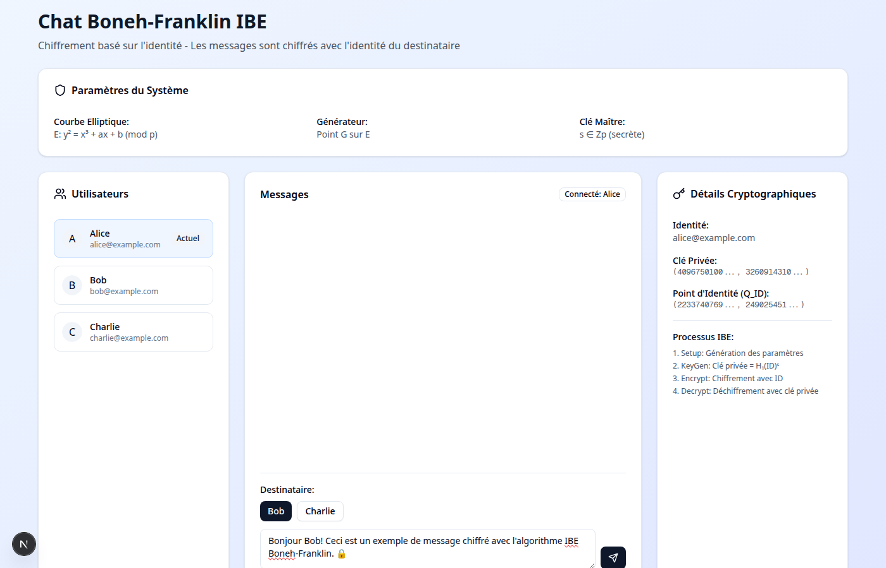

# Chat Boneh-Franklin IBE


Une application de chat sécurisée utilisant l'algorithme de chiffrement basé sur l'identité (IBE) de Boneh-Franklin. Cette application démontre les concepts de cryptographie avancée dans un environnement interactif et convivial.


*Interface principale de l'application de chat Boneh-Franklin*

## 🚀 Démarrage rapide

### Prérequis
- Node.js 18+ 
- pnpm (recommandé) ou npm

### Installation et lancement

1. **Cloner le projet**
   ```bash
   git clone <votre-repo>
   cd bf-chat
   ```

2. **Installer les dépendances**
   ```bash
   pnpm install
   ```

3. **Lancer l'application**
   ```bash
   pnpm dev
   ```

4. **Ouvrir dans le navigateur**
   Naviguez vers [http://localhost:3000](http://localhost:3000)

## 🛠️ Commandes disponibles

```bash
# Développement
pnpm setup           # Installation + lancement automatique
pnpm dev              # Lancer le serveur de développement
pnpm build            # Construire l'application pour la production
pnpm start            # Lancer l'application en mode production

# Qualité de code
pnpm lint             # Vérifier le code avec ESLint
pnpm lint:fix         # Corriger automatiquement les erreurs ESLint

# Utilitaires
pnpm screenshot       # Prendre un screenshot automatique de l'app
pnpm clean            # Nettoyer les fichiers temporaires
```

## 📖 À propos de l'application

### Qu'est-ce que c'est ?

Cette application implémente un système de chat utilisant le **chiffrement basé sur l'identité (IBE)** selon l'algorithme de Boneh-Franklin. Contrairement aux systèmes de chiffrement traditionnels, l'IBE permet de chiffrer des messages en utilisant directement l'identité du destinataire (comme son email) sans avoir besoin d'échanger des clés publiques au préalable.

### Fonctionnalités principales

- 🔐 **Chiffrement IBE** : Messages chiffrés avec l'identité du destinataire
- 👥 **Multi-utilisateurs** : Trois utilisateurs prédéfinis (Alice, Bob, Charlie)
- 🔄 **Changement d'utilisateur** : Basculer entre différents utilisateurs
- 🔓 **Déchiffrement interactif** : Cliquer pour décrypter les messages reçus
- 📊 **Détails cryptographiques** : Visualisation des clés et paramètres
- 🧪 **Tests automatiques** : Vérification du chiffrement/déchiffrement au démarrage

## 🔬 Comment ça fonctionne

### Algorithme Boneh-Franklin

L'application implémente une version simplifiée de l'algorithme Boneh-Franklin :

1. **Setup** : Génération des paramètres système
   - Courbe elliptique `E: y² = x³ + 1`
   - Générateur `G` sur la courbe
   - Clé maître secrète `s`
   - Clé publique `P_pub = s·G`

2. **Génération de clés (KeyGen)**
   - Hash de l'identité : `H₁(ID) → Q_ID`
   - Clé privée : `d_ID = s·Q_ID`

3. **Chiffrement (Encrypt)**
   - Génération d'un nombre aléatoire `r`
   - Calcul de `U = r·G`
   - Clé de session basée sur l'identité
   - Chiffrement XOR avec `H₂(clé_de_session)`

4. **Déchiffrement (Decrypt)**
   - Utilisation de la clé privée pour recalculer la clé de session
   - Déchiffrement XOR pour récupérer le message original

### Architecture technique

```
├── app/page.tsx              # Interface utilisateur principale
├── lib/boneh-franklin.ts     # Implémentation de l'algorithme IBE
├── components/ui/            # Composants d'interface (shadcn/ui)
├── scripts/screenshot.js     # Script automatisé pour les captures d'écran
└── public/                   # Assets statiques
```

### Structure des données

- **SystemParameters** : Paramètres cryptographiques globaux (courbe, générateur, clés)
- **UserKeys** : Clés utilisateur (identité, clé privée, point d'identité)
- **Point** : Représentation des points sur la courbe elliptique
- **Message** : Structure des messages chiffrés avec métadonnées

## 🎯 Utilisation

### Interface utilisateur

1. **Panneau Utilisateurs** (gauche)
   - Sélectionner l'utilisateur actuel
   - Voir les identités (emails)

2. **Zone de Chat** (centre)
   - Voir tous les messages échangés
   - Messages chiffrés affichés avec 🔒
   - Cliquer sur le cadenas pour décrypter

3. **Panneau Cryptographique** (droite)
   - Voir l'identité actuelle
   - Clés privées (tronquées)
   - Paramètres système

### Scénario d'utilisation

1. **Sélectionner Alice** comme utilisateur actuel
2. **Choisir Bob** comme destinataire
3. **Écrire un message** : "Bonjour Bob !"
4. **Envoyer** → Le message est chiffré avec l'identité de Bob
5. **Basculer vers Bob**
6. **Cliquer sur le cadenas** → Le message se décrypte automatiquement

## 🔧 Détails techniques

### Implémentation

- **Frontend** : Next.js 15 + TypeScript
- **UI** : Tailwind CSS + shadcn/ui
- **Cryptographie** : Implémentation custom JavaScript/TypeScript
- **Big Numbers** : Support BigInt natif ES2020+

### Simplifications pour la démo

⚠️ **Important** : Cette implémentation est à des fins éducatives uniquement.

- **Couplage bilinéaire simplifié** : Utilise des hash au lieu du couplage de Weil réel
- **Courbe elliptique simplifiée** : Paramètres réduits pour les performances
- **Clé maître exposée** : Stockée côté client pour la démo
- **Pas de validation de sécurité** : Aucune protection contre les attaques

### Sécurité en production

Pour un usage réel, il faudrait :
- Implémentation du vrai couplage de Weil
- Courbes elliptiques sécurisées (P-256, etc.)
- Protection de la clé maître
- Validation des entrées
- Audit de sécurité complet

## 🧪 Tests et débogage

L'application inclut des tests automatiques qui s'exécutent au démarrage :

```typescript
// Teste plusieurs types de messages
const testMessages = [
  "Hello World!",
  "Bonjour tout le monde 🌍",
  "Test avec des caractères spéciaux: éàèç",
  "123456789",
  "Message très long pour tester..."
]
```

Les logs de débogage sont visibles dans la console du navigateur (F12).

## 🔧 Dépannage

### Problèmes courants

**L'application ne se lance pas :**
- Vérifiez que Node.js 18+ est installé : `node --version`
- Supprimez `node_modules` et réinstallez : `rm -rf node_modules && pnpm install`

**Les messages ne se déchiffrent pas :**
- Ouvrez la console (F12) pour voir les logs de débogage
- Vérifiez que vous êtes connecté avec le bon utilisateur (destinataire)
- Les tests automatiques au démarrage indiquent si l'algo fonctionne

**Erreur lors du screenshot :**
- Assurez-vous que l'application tourne sur http://localhost:3000
- Installez Chrome pour Puppeteer : `npx puppeteer browsers install chrome`

### FAQ

**Q: Pourquoi les messages d'autres utilisateurs restent chiffrés ?**
R: C'est normal ! En IBE, seul le destinataire peut déchiffrer. Si vous n'êtes pas le destinataire, vous ne pouvez pas lire le message.

**Q: L'implémentation est-elle sécurisée pour la production ?**
R: Non, c'est uniquement éducatif. Une vraie implémentation nécessiterait des courbes sécurisées et un audit complet.

**Q: Comment ajouter de nouveaux utilisateurs ?**
R: Modifiez le tableau `initialUsers` dans `app/page.tsx` avec de nouvelles identités.

## 🤝 Contribution

Ce projet est à des fins éducatives. Les contributions sont les bienvenues pour :
- Améliorer l'interface utilisateur
- Ajouter des tests unitaires
- Optimiser les performances
- Corriger les bugs

Consultez le [Guide de Contribution](./CONTRIBUTING.md) pour plus de détails.

## 📚 Références

- [Boneh-Franklin IBE Paper](https://crypto.stanford.edu/~dabo/papers/bfibe.pdf)
- [Identity-Based Encryption](https://en.wikipedia.org/wiki/Identity-based_encryption)
- [Elliptic Curve Cryptography](https://en.wikipedia.org/wiki/Elliptic-curve_cryptography)
- [Bilinear Pairings](https://en.wikipedia.org/wiki/Pairing-based_cryptography)

## 📄 Licence

Ce projet est fourni sous licence MIT à des fins éducatives. Voir le fichier [LICENSE](./LICENSE) pour plus de détails.

**⚠️ Clause éducative** : Cette implémentation est simplifiée et ne doit pas être utilisée en production.

---

**⚠️ Avertissement** : Cette implémentation est uniquement à des fins d'apprentissage et de démonstration. Ne pas utiliser en production sans audit de sécurité complet.
